

 

### About Me

I'm a DevOps and cloud engineer based in Pune, India, focused on **cloud infrastructure, CI/CD and automation**. I like turning repetitive manual work into reliable, repeatable pipelines, and I build systems that deploy themselves, recover on their own, and need less babysitting. Alongside DevOps, I work on applied AI and algorithmic trading systems.

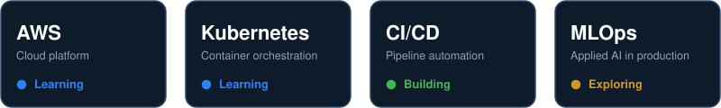

 

| Role | Based in | Core focus | Side tracks |
|:---:|:---:|:---:|:---:|
| DevOps / Cloud engineer | Pune, India | Cloud, CI/CD, automation | Applied AI, trading systems |

**Open to:** DevOps and cloud roles &nbsp;·&nbsp; collaboration on automation projects

### How I Ship

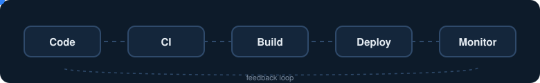

Code goes in, gets tested and packaged automatically, ships to the cloud, and what I observe feeds the next change.

  

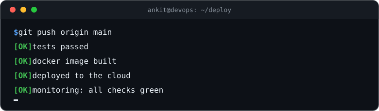

### Toolkit

| Layer | Tools |
|---|---|
| **Languages** | Python, Java |
| **Containers & orchestration** | Docker, Kubernetes |
| **Cloud** | AWS |
| **CI/CD & version control** | GitHub Actions, Git, GitHub |
| **Systems** | Linux |
| **Data** | MongoDB |

### Projects

<a href="https://github.com/ankit-logs/docker-task-api">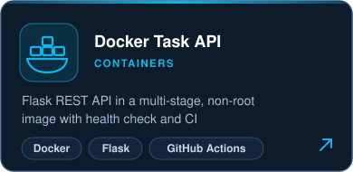</a>
<a href="https://github.com/ankit-logs/aws-container-deploy">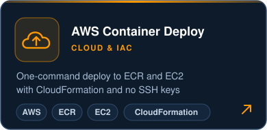</a>
 
<a href="https://github.com/ankit-logs/REPO-NAME">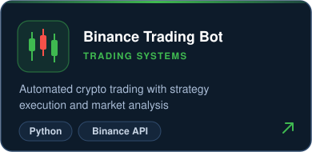</a>
<a href="https://github.com/ankit-logs/REPO-NAME">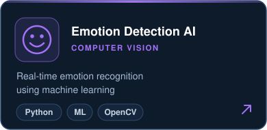</a>
 
<a href="https://github.com/ankit-logs/REPO-NAME">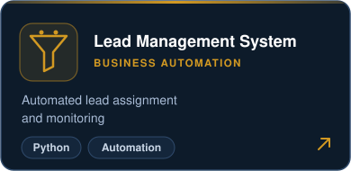</a>
<a href="https://github.com/ankit-logs/REPO-NAME">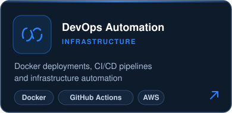</a>

### Roadmap

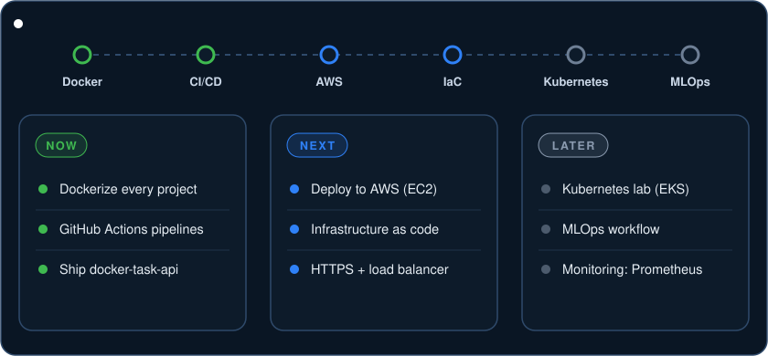

### Engineering Principles

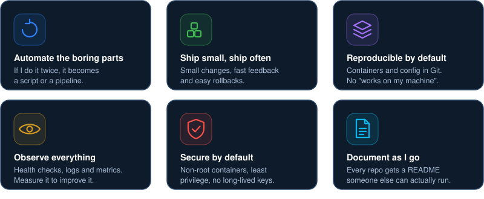

### GitHub Activity

<picture>
  <source media="(prefers-color-scheme: dark)" srcset="https://raw.githubusercontent.com/ankit-logs/ankit-logs/output/github-snake-dark.svg">
  
</picture>

 

<table>
<tr>
<td valign="middle">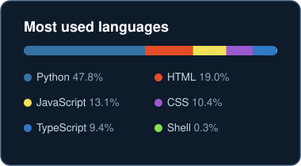</td>
<td valign="middle"></td>
</tr>
</table>

### Get in Touch

Ask me about **Docker deployments · CI/CD automation · Binance API bots · getting started with cloud and DevOps**

 

  

*Automate everything. Learn continuously. Build fearlessly.*

