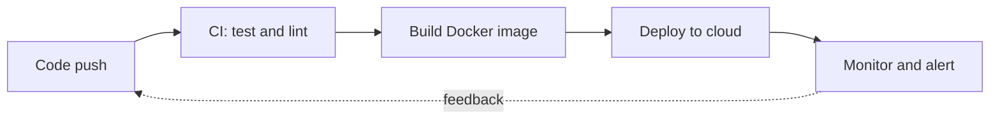

**I build systems that deploy themselves, recover on their own, and need less babysitting.**

---

### About

DevOps engineer based in India, working across **cloud infrastructure, CI/CD, and automation**, with a side interest in **applied AI and algorithmic trading systems**. I like turning repetitive manual work into reliable, repeatable pipelines.

---

### How I work

| Principle | What it means in practice |
|---|---|
| **Automate the boring parts** | If I do it twice, it becomes a script or a pipeline |
| **Ship small, ship often** | Small changes, fast feedback, easy rollbacks |
| **Reproducible by default** | Containers and config in version control, no "works on my machine" |
| **Observe everything** | If it can't be measured, it can't be improved |

---

### Delivery pipeline I work with

---

### Current focus

| Area | Status |
|---|---|
| Cloud (AWS) | Learning and building hands-on labs |
| Container orchestration (Kubernetes) | Learning |
| CI/CD pipelines | Building and refining |
| MLOps | Exploring |

---

### Tech stack

---

### Selected projects

| Project | What it does | Stack |
|---|---|---|
| [**Binance Trading Bot**](https://github.com/ankit-logs/REPO-NAME) | Automated crypto trading with strategy execution and market analysis via the Binance API | Python, Binance API |
| [**Emotion Detection AI**](https://github.com/ankit-logs/REPO-NAME) | Real-time emotion recognition using computer vision and machine learning | Python, ML, OpenCV |
| [**Lead Management System**](https://github.com/ankit-logs/REPO-NAME) | Automated lead assignment and monitoring | Python, Automation |
| [**DevOps Automation**](https://github.com/ankit-logs/REPO-NAME) | Docker deployments, CI/CD pipelines, and infrastructure automation | Docker, GitHub Actions, AWS |

---

### GitHub activity

---

*Automate everything. Learn continuously. Build fearlessly.*

